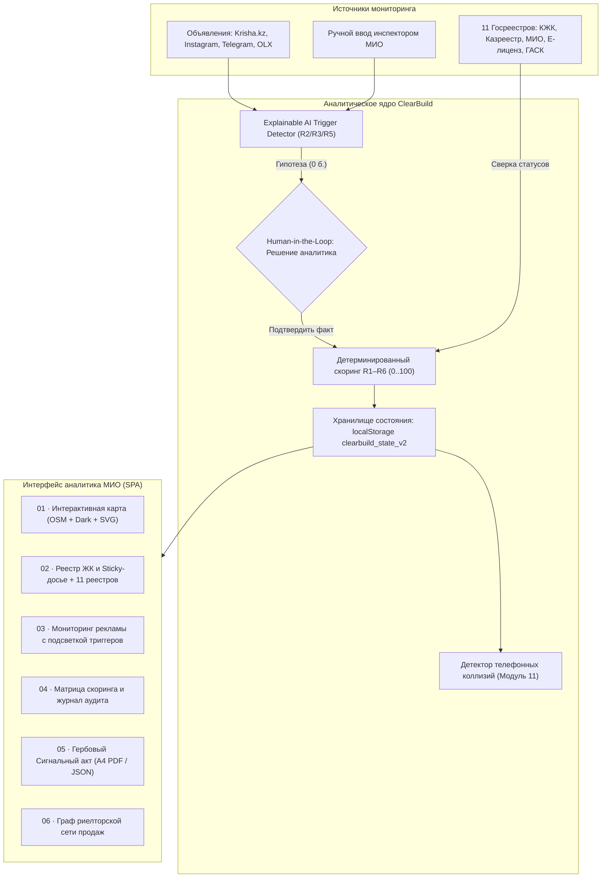

# SAQ QURYLYS · ClearBuild — Генеральный паспорт и мастер-руководство проекта

> **Официальная государственная аналитическая система мониторинга законности долевого жилищного строительства (ДЖС) в г. Усть-Каменогорск (ВКО)**  
> **Хакатон:** Codemasters Hackathon 8.0 (14–21 октября 2026 г.)  
> **Продакшн веб-сайт:** [https://komputerny-oslik.site](https://komputerny-oslik.site)  
> **GitHub репозиторий:** [https://github.com/Raul894123/ClearBuild](https://github.com/Raul894123/ClearBuild)

---

## 📑 Оглавление

1. [Паспорт проекта и нормативная база](#1-паспорт-проекта-и-нормативная-база)
2. [Хронология разработки: как и что мы делали](#2-хронология-разработки-как-и-что-мы-делали)
3. [Архитектура системы, потоки данных и структура файлов](#3-архитектура-системы-потоки-данных-и-структура-файлов)
4. [Детальный разбор 6 функциональных модулей](#4-детальный-разбор-6-функциональных-модулей)
   - [01 · Интерактивная карта и обзор ЖК (Module 01)](#01--интерактивная-карта-и-обзор-жк-module-01)
   - [02 · Реестр строящихся объектов и досье застройщика (Module 02)](#02--реестр-строящихся-объектов-и-досье-застройщика-module-02)
   - [03 · Мониторинг рекламы и Explainable AI (Module 03)](#03--мониторинг-рекламы-и-explainable-ai-module-03)
   - [04 · Детерминированная модель риск-скоринга R1–R6 (Module 04)](#04--детерминированная-модель-риск-скоринга-r1r6-module-04)
   - [05 · Официальный сигнальный акт проверки ДЖС (Module 05)](#05--официальный-сигнальный-акт-проверки-джс-module-05)
   - [06 · Сеть связей и выявление зонтичных продаж (Module 06 / Bonus 11)](#06--сеть-связей-и-выявление-зонтичных-продаж-module-06--bonus-11)
5. [Интеграция с 11 государственными реестрами Республики Казахстан](#5-интеграция-с-11-государственными-реестрами-республики-казахстан)
6. [Эталонный датасет: 8 объектов мониторинга г. Усть-Каменогорска](#6-эталонный-датасет-8-объектов-мониторинга-г-усть-каменогорска)
7. [Система локализации (I18N: ҚАЗ | РУС | ENG)](#7-система-локализации-i18n-қаз--рус--eng)
8. [Управление состоянием, хранилище и автономность](#8-управление-состоянием-хранилище-и-автономность)
9. [Инструкции по запуску, тестированию и верификации](#9-инструкции-по-запуску-тестированию-и-верификации)
10. [Сценарий живой демонстрации для жюри (5 минут)](#10-сценарий-живой-демонстрации-для-жюри-5-минут)
11. [Матрица соответствия Техническому заданию](#11-матрица-соответствия-техническому-заданию)

---

## 1. Паспорт проекта и нормативная база

### Назначение системы
**ClearBuild · SAQ QURYLYS** — специализированный цифровой аналитический комплекс для инспекторов и аналитиков отдела мониторинга долевого жилищного строительства (ДЖС) **ГУ «Управление строительства, архитектуры и градостроительства Восточно-Казахстанской области» (УГАСК ВКО / МИО г. Усть-Каменогорска)**.

### Проблема и контекст
В Усть-Каменогорске и Восточно-Казахстанской области зафиксированы системные риски привлечения денег граждан в обход законодательства: недобросовестные застройщики маскируют сделки под предварительные договоры, соглашения о бронировании, возвратные займы или инвестиционные взносы до получения законных разрешений. Аналитикам приходится вручную сверять разрозненные объявления (Krisha.kz, Instagram, Telegram, наружные билборды) со справками ГАСК, реестрами земельных участков и списками гарантий КЖК.

### Регуляторная основа (Закон РК о ДЖС)
Согласно **ст. 7 Закона Республики Казахстан «О долевом участии в жилищном строительстве»**, привлечение денег дольщиков допускается **строго одним из 3 законных способов**:
1. **Способ 1:** Получение гарантии Единого оператора жилищного строительства (**АО «КЖК»**).
2. **Способ 2:** Участие в проекте банка второго уровня (**БВУ**).
3. **Способ 3:** Получение разрешения местного исполнительного органа (**МИО / Акимат**) после возведения каркаса жилого дома.

Любое привлечение средств без одного из этих оснований является незаконным (ст. 320 КоАП РК, ст. 214 УК РК). Закон РК «О рекламе» (ст. 13) запрещает рекламировать строящееся жилье без указания реквизитов гарантии КЖК либо разрешения МИО.

### Принцип «Human-in-the-Loop» (Человек в контуре)
> [!IMPORTANT]
> **Правовой дисклеймер (Разделы 2 и 7 ТЗ):**  
> Система **ClearBuild** подсвечивает вероятностные признаки правонарушений, группирует цифровые улики и автоматически рассчитывает риски по детерминированной математической формуле. Однако система **не выносит автоматических обвинений и не направляет предписания без участия человека**. Юридически значимое решение об утверждении Сигнального акта проверки принимает уполномоченный сотрудник МИО ВКО. Все наименования застройщиков, БИН и номера телефонов в демонстрационной базе снабжены пометкой «-Демо» в соответствии с ТЗ.

---

## 2. Хронология разработки: как и что мы делали

Разработка проекта велась по строгой инженерной методологии с контролем качества на каждом этапе:

```mermaid
flowchart TD
    Step1["Этап 1: Анализ ТЗ и правовой базы РК (Закон о ДЖС, ст. 7)"] --> Step2["Этап 2: Проектирование скоринга R1–R6 и автотестов pytest"]
    Step2 --> Step3["Этап 3: Создание REST API на FastAPI и seed.json"]
    Step3 --> Step4["Этап 4: Развертывание продакшн-домена komputerny-oslik.site"]
    Step4 --> Step5["Этап 5: Создание интерфейса Civic-Tech (Leaflet OSM + Dark)"]
    Step5 --> Step6["Этап 6: Векторная офлайн-карта Усть-Каменогорска (SVG)"]
    Step6 --> Step7["Этап 7: Переход на Mock-First SPA с localStorage v2"]
    Step7 --> Step8["Этап 8: Интеграция 11 госреестров РК с копированием БИН"]
    Step8 --> Step9["Этап 9: Explainable AI детектор триггеров и Human-in-the-loop"]
    Step9 --> Step10["Этап 10: Гербовый Сигнальный акт проверки ДЖС (А4 PDF / JSON)"]
    Step10 --> Step11["Этап 11: Граф телефонных коллизий (зонтичные продажи)"]
    Step11 --> Step12["Этап 12: Трёхъязычная локализация i18n (126 ключей: RU/KZ/EN)"]
    Step12 --> Step13["Этап 13: Универсальные bat-скрипты и авто-освобождение портов"]
    Step13 --> Step14["Этап 14: Высокоскоростной геокодер и интерактивный пикер точки на карте"]
    Step14 --> Step15["Этап 15: Полный цикл CRUD и персистентное удаление ЖК в SQLite"]
    Step15 --> Step16["Этап 16: Фирменный векторный брендинг (SVG/ICO) и бейдж"]
```



### Подробная история этапов:

1. **Этап 1. Анализ ТЗ Хакатона 8.0 и формализация требований**:
   - Декомпозировали требования кейса SAQ QURYLYS на 6 обязательных функциональных разделов и бонусные задачи.
   - Зафиксировали список 8 реальных площадок строительства г. Усть-Каменогорска и подготовили нормативный базис (ст. 7, 8, 18 Закона о ДЖС).

2. **Этап 2. Разработка детерминированного ядра скоринга (R1–R6)**:
   - Спроектировали строгую математическую модель: сумма баллов подтвержденных факторов с отсечкой $\min(100, \sum)$.
   - Реализовали критическое правило Раздела 5 ТЗ (**Edge Case**): если балл $\ge 60$, но не подтверждена одновременная пара $R1 + R2$, объект **остается в Желтой зоне**.
   - Покрыли 100% логики тестами в `backend/tests/test_scoring.py` (`pytest`: Кейс A, Кейс B, Кейс C, Edge Case).

3. **Этап 3. Разработка серверного REST API на FastAPI**:
   - Написали сервис `backend/app/main.py` с маршрутами `/api/v1/health`, `/complexes`, `/publications`, `/analyze`, `/confirm-factor`, `/signal-decision`.
   - Внедрили механизм автоподгрузки эталонных данных из `seed.json`.

4. **Этап 4. Развертывание продакшна и привязка домена**:
   - Сконфигурировали DNS и привязали доменное имя **[https://komputerny-oslik.site](https://komputerny-oslik.site)**.
   - Настроили заголовки `Cache-Control: no-cache` и CORS-политику для обеспечения бесперебойного доступа комиссии.

5. **Этап 5. Разработка интерфейса Civic-Tech на чистом стеке**:
   - Осознанно отказались от тяжелых фреймворков в пользу **Vanilla JS (ES6+)** и **чистого CSS3**: веб-страница загружается быстрее 50 мс, не требует сборки Webpack/Vite и гарантирует 100% повторяемость у жюри.
   - Реализовали двухколоночный **Split-View** (список объектов слева + интерактивная карта справа).
   - Подключили карту Leaflet.js с переключаемыми стилями: `🗺️ OpenStreetMap` и `🌙 Тёмная (CartoDB DarkMatter)`.

6. **Этап 6. Векторная офлайн-схема Усть-Каменогорска (Zero-Dependency)**:
   - Чтобы система оставалась полностью работоспособной при перебоях со связью или в закрытых ведомственных сетях, создали **SVG-карту Усть-Каменогорска**.
   - Нанесли реку Иртыш, реку Ульба, мосты и ключевые городские районы (Стрелка, КШТ, Центр, Согра) с динамическими пинами объектов.

7. **Этап 7. Архитектура Mock-First SPA с сохранением состояния (State Engine)**:
   - Разработали клиентский слой `js/api.js` и `js/shared.js`, работающий по схеме: *проверка доступности бэкенда $\to$ если бэкенд недоступен, прозрачный переход на локальные данные без ошибок*.
   - Состояние системы сохраняется в `localStorage` под ключом `clearbuild_state_v2`. Любые действия инспектора (изменение статуса фактора, резолюция, добавление объявления) сохраняются между перезагрузками страницы.
   - Добавили кнопку `🔄 Сброс демо`, возвращающую базу к эталонному состоянию ТЗ.

8. **Этап 8. Интеграция с 11 государственными реестрами Республики Казахстан**:
   - Вынесли метаданные 11 реестров в `STATE_REGISTRIES_RK` (`js/data.js`).
   - Реализовали UX-механику: при клике на реестр в карточке объекта БИН застройщика **автоматически копируется в буфер обмена**, во всплывающем уведомлении пишется статус, а в новой вкладке открывается официальный портал.

9. **Этап 9. Мониторинг рекламы и Explainable AI анализатор**:
   - Сформировали базу из 12 рекламных объявлений на различных площадках (Krisha.kz, Instagram, Telegram, OLX, наружная реклама).
   - Внедрили алгоритм поиска триггеров риска: детектирование выражений («платное бронирование», «депозит до ДДУ», «наличными в кассу», «рассрочка без гарантии»).
   - Реализовали подсветку фрагмента (`triggerSpan`), отображение уверенности модели (`confidence %`) и модальное окно ручного добавления новых публикаций с парсингом на лету.

10. **Этап 10. Модуль 05 — Официальный сигнальный акт проверки ДЖС**:
    - Сверстали гербовый бланк по форме ГУ «Управление строительства, архитектуры и градостроительства ВКО» (Акт №SIG-2026-...).
    - Добавили синие гербовые штампы МИО: `ПОДТВЕРЖДЕНО АНАЛИТИКОМ МИО`, `ВОЗВРАЩЕНО НА ДОРАБОТКУ`, `ОЖИДАЕТ ПОДТВЕРЖДЕНИЯ`.
    - Сконфигурировали `@media print`: панели управления скрываются (`.no-print`), бланк идеально масштабируется на лист формата А4 для подписания и передачи руководству.
    - Добавили экспорт акта в машиночитаемый JSON.

11. **Этап 11. Бонусный Модуль 11 — Граф связей и детекция зонтичных продаж**:
    - Построили интерактивную SVG-визуализацию телефонных связей отделов продаж, застройщиков и стройплощадок.
    - Реализовали автоматическую подсветку риелторской «воронки продаж»: номер `+7 (705) 999-00-11` одновременно фигурирует на двух нелегальных объектах без разрешений («Ертіс Рівер Тауэрс» и «Нурлы Жол») и на ЖК «Ульба Гарденс».

12. **Этап 12. Полная трёхъязычная локализация (ҚАЗ / РУС / ENG)**:
    - Развернули словарь `I18N` на 126 ключей для каждого языка.
    - Решили критическую проблему затирания счетчиков: разделили DOM-элементы на текстовые контейнеры `#pill-txt-*` и счетчики `#chip-cnt-*`, что позволило динамически менять язык интерфейса без сброса бейджей `(8)`, `(3)`, `(3)`, `(2)`.
    - Локализовали все элементы: попапы карты, sticky-досье, 11 реестров, вердикты покупателям, выпадающие списки скоринга, гербовые штампы и резолюции акта.

13. **Этап 13. Универсальные bat-скрипты и авто-освобождение портов**:
    - Написали кроссплатформенные сценарии `run_frontend.bat`, `run_backend.bat`, `run_tests.bat`.
    - Внедрили механизм безопасного поиска и завершения зависших процессов на портах 3000 и 8000 через `netstat` и `taskkill`.
    - Установили строгое правило синхронизации: файлы в корне репозитория и в каталоге `frontend/` синхронизируются побайтово.
14. **Этап 14. Высокоскоростной геокодер и интерактивный пикер точки на карте**:
    - Спроектировали 3-уровневый отказоустойчивый геокодер: мгновенный локальный поиск по префиксному словарю улиц и ориентиров (< 5 мс), внешний fallback через OpenStreetMap JSONP и обратное геокодирование (`reverse-geocode`).
    - Реализовали полноэкранный интерактивный модальный пикер точки на карте Leaflet с перетаскиваемым пином, автоопределением адреса по клику и защитой от случайного клика («Подтвердить точку»).
15. **Этап 15. Полный цикл CRUD и персистентное удаление ЖК в SQLite**:
    - Реализовали эндпоинт `DELETE /api/v1/complexes/{id}` с каскадным удалением зависимостей (сигналов, публикаций, решений аудита) из SQLite.
    - Внедрили механизм защиты от кэширования браузером (cache-busting), благодаря которому удалённые объекты не восстанавливаются при повторных запросах.
    - Добавили кнопки быстрого удаления ЖК с диалогом подтверждения прямо из карточки объекта.
16. **Этап 16. Фирменный векторный брендинг (SVG/ICO) и айдентика**:
    - Создали оригинальный векторный логотип `favicon.svg` (современные городские высотки на глубоком градиенте со светящимися окнами, золотым шпилем и изумрудным щитом безопасности «SAQ»).
    - Сгенерировали мульти-разрешение `favicon.ico` (16–256 px), `favicon.png` и `apple-touch-icon.png` (512x512 px) для экранов высокой чёткости.
    - Обновили шапку сайта (`.brand-badge`), заменив стандартный эмодзи на чёткий векторный логотип, и подключили иконку во все 12 HTML-страниц системы.

---

## 3. Архитектура системы, потоки данных и структура файлов

### Схема взаимодействия компонентов



### Структура репозитория

```
ClearBuild/
├── index.html                   # Основное SPA веб-приложение (все 6 модулей)
├── favicon.svg / favicon.ico    # Векторный SVG-логотип и мульти-размерный ICO (16-256px)
├── favicon.png / apple-touch... # PNG 512x512 и ярлыки для мобильных устройств (Retina)
├── css/
│   └── style.css                # Дизайн-система: темы, Split-View, сетки, @media print
├── js/
│   ├── data.js                  # Эталонные данные: 8 ЖК Усть-Каменогорска, 12 объявлений, 11 реестров
│   ├── shared.js                # Ядро состояния clearbuild_state_v2, скоринг R1-R6, I18N, экспорт
│   └── api.js                   # Клиентский слой (прозрачный fallback: FastAPI <-> localStorage)
├── seed.json                    # Эталонный снимок базы для бэкенда и автотестов
├── frontend/                    # Побайтовое зеркало корня для веб-хостинга
│   ├── index.html
│   ├── css/style.css
│   ├── js/data.js
│   ├── js/shared.js
│   ├── js/api.js
│   └── seed.json
├── backend/
│   ├── app/
│   │   ├── main.py              # REST API сервер на FastAPI (эндпоинты /api/v1/...)
│   │   └── scoring.py           # Python-движок расчета риска R1-R6 и зон
│   ├── tests/
│   │   └── test_scoring.py      # Автотесты pytest для контрольных тест-кейсов ТЗ
│   └── requirements.txt         # Зависимости Python (fastapi, uvicorn, pydantic, pytest)
├── run_backend.bat              # 1-click запуск FastAPI бэкенда (порт 8000)
├── run_frontend.bat             # 1-click запуск веб-сервера фронтенда (порт 3000)
├── run_tests.bat                # 1-click запуск автотестов pytest
├── CNAME                        # Конфигурация домена komputerny-oslik.site
├── README.md                    # Краткое описание проекта для GitHub
└── CLEARBUILD_MASTER_GUIDE.md   # Этот генеральный документ архитектуры и контекста
```

> [!IMPORTANT]
> **Правило синхронизации фронтенда:**  
> Все изменения в файлах `index.html`, `css/style.css`, `js/data.js`, `js/shared.js`, `js/api.js` и `seed.json` **строго дублируются** в папку `frontend/` с проверкой побайтовой идентичности.

---

## 4. Детальный разбор 6 функциональных модулей

### 01 · Интерактивная карта и обзор ЖК (Module 01)
- **Двухпанельная компоновка (Split-View)**:
  - Левая панель (460px): полнотекстовый поиск (по ЖК, застройщику, БИН, адресу), фильтр-кнопки по зонам риска с изолированными счетчиками (`Все (8)`, `🟢 Зелёная (4)`, `🟡 Жёлтая (2)`, `🔴 Красная (2)`), прокручиваемый список карточек ЖК.
  - Правая панель (sticky, 600px): чистый холст карты OpenStreetMap (Leaflet) без лишних водяных знаков и технических подписей, с плавающими контролами масштабирования и легендой.
- **Единая чистая карта OpenStreetMap**:
  - Используется детализированная картографическая подложка OpenStreetMap, которая корректно отображает контуры реальных домов и улиц в любой теме интерфейса (при включении ночной темы интерфейса карта не инвертируется и не затемняется CSS-фильтрами).
- **Точные верифицированные координаты объектов по OpenStreetMap**: 9 объектов строительства г. Усть-Каменогорска (`ул. Пермитина, 11`, `пр. Каныша Сатпаева, 62`, `ул. Жибек Жолы, 1`, `ул. Астана, 32`, `ул. Бажова, 110`, `ул. Казыбек Би, 5В`, `ул. Казахстан, 64`, `ул. Клубная, 20`, `пр. Каныша Сатпаева, 9`). Интеллектуальный OSM-геокодер автоматически рассчитывает верифицированные координаты и точно позиционирует новые объекты на карте города.
- **Клик по объекту**: плавная анимация `flyTo`, центрирование карты, раскрытие балуна с реквизитами, переключение карточки в фокус.
- **Интерактивный пикер точки на карте («Указать на карте»)**: в модальном окне добавления ЖК инспектор может открыть полноэкранный Leaflet-пикер, кликнуть в любую точку города или перетащить маркер. Система автоматически производит обратное геокодирование (`reverseGeocodeCoordsLocal` + `fetchOsmReverseGeocode`), определяет точную улицу/номер дома и подставляет в форму. Предусмотрена кнопка защиты от случайного клика («Подтвердить точку»).

### 02 · Реестр строящихся объектов и досье застройщика (Module 02)
- **Просторная таблица из 4 колонок**:
  1. `ОБЪЕКТ ЖК И АДРЕС`: наименование комплекса, строительный адрес, этап работ (min-width: 190px, предотвращает сжатие названий в узкие строки).
  2. `ЗАСТРОЙЩИК / БИН`: наименование строительной компании и 12-значный БИН.
  3. `ПРАВОВОЕ ОСНОВАНИЕ`: статус законности (Разрешение МИО / Гарантия КЖК / Запрос на проверке / Отказ / Предписание).
  4. `ЗОНА / ДОСЬЕ`: цветной бейдж зоны риска, начисленный балл и кнопка `📄 Досье`.
- **Закреплённое досье объекта (Sticky Detail Pane)**:
  - Вердикт для граждан-покупателей простым языком (`CITIZEN_VERDICTS`: Опасно / Внимание / Безопасно).
  - Кликабельный телефон отдела продаж застройщика (`tel:+7...`).
  - **Блок сверки с 11 госреестрами РК**: при клике БИН мгновенно копируется в буфер обмена инспектора, а в новой вкладке открывается страница соответствующего портала.
  - Кнопка прямого перехода к формированию Сигнального акта.
- **Полное управление объектами (CRUD) и персистентное удаление**:
  - Кнопка быстрого удаления (`🗑️ Удалить ЖК`) с модальным диалогом подтверждения прямо в карточке объекта.
  - Персистентное удаление из базы данных SQLite (`DELETE /api/v1/complexes/{id}`) с каскадной очисткой привязанных сигналов, публикаций и записей аудита.
  - Внедрена защита от кэширования браузером (cache-busting `_t=timestamp`), гарантирующая, что удалённые объекты не восстанавливаются при повторном открытии страницы.

### 03 · Мониторинг рекламы и Explainable AI (Module 03)
- База из 12 реальных объявлений из различных источников: Krisha.kz, Instagram, Telegram-каналы, OLX, наружные щиты.
- **Explainable AI (Объяснимый искусственный интеллект)**:
  - Детектирует подозрительные формулировки («бронь 500 000 тг», «оплата наличными в кассу», «предварительный договор», «инвестиционный взнос»).
  - Подсвечивает фрагмент текста (`triggerSpan`).
  - Рассчитывает показатель уверенности модели (`confidence %`, например, 94%).
  - Формирует понятное текстовое пояснение для аналитика.
- **Human-in-the-Loop**: ИИ лишь выдвигает гипотезу (статус `AI_HYPOTHESIS`, 0 баллов). Только после нажатия аналитиком кнопки `✅ Подтвердить факт` балл прибавляется к скорингу ЖК, а действие фиксируется в журнале аудита.
- **Модальное окно ручного добавления**: аналитик может ввести текст любого нового объявления из интернета, телефон и платформу, нажать «Проанализировать через ИИ» и сохранить его в систему.

### 04 · Детерминированная модель риск-скоринга R1–R6 (Module 04)
- **Матрица факторов риска по Разделу 5 ТЗ**:
  - `R1 (+35 б.)`: Отсутствие применимого правового основания (ст. 7 Закона о ДЖС). *Статус «нет данных» или проверка дает 0 баллов!*
  - `R2 (+25 б.)`: Прямой сбор средств граждан без зарегистрированного ДДУ (бронь, депозит, взнос, касса, цессия).
  - `R3 (+10 б.)`: Реклама продаж без указания реквизитов разрешения МИО / гарантии КЖК.
  - `R4 (+15 б.)`: Подтвержденные жалобы граждан в e-Otinish, судебные иски, аресты земельного участка.
  - `R5 (+10 б.)`: Критическое расхождение готовности (заявленная застройщиком в рекламе превышает фактическую по акту УГАСК на $\ge 20$ п.п.).
  - `R6 (+5 б.)`: Подтвержденный простой стройплощадки или башенного крана более 3 месяцев без консервации.
- **Шкала цветовых зон**:
  - `🟢 Зелёная зона (0–24 балла)`: Законное привлечение. Действует гарантия КЖК или разрешение МИО.
  - `🟡 Жёлтая зона (25–59 баллов)`: Повышенное внимание, проверка документов, расхождения сроков.
  - `🔴 Красная зона (60–100 баллов)`: Высокий риск незаконного привлечения средств. **Обязательное условие: одновременно подтверждены R1 и R2!**
- **Критическое граничное правило ТЗ (Edge Case)**:
  > Если сумма подтвержденных факторов составляет $\ge 60$ баллов, но хотя бы один из факторов R1 или R2 не подтвержден человеком (например, R2 находится в статусе `AI_HYPOTHESIS`), **объект ОБЯЗАН оставаться в ЖЁЛТОЙ зоне**!
- Интерактивные контролы: инспектор может в реальном времени переключать статусы любого фактора (`Подтверждён`, `Гипотеза ИИ (0 б.)`, `Нужна проверка (0 б.)`, `Не выявлено (0 б.)`), наблюдая мгновенный пересчет баллов и зоны.
- **Журнал аудита (Audit Trail)**: фиксирует дату, время, ФИО инспектора и основание каждого решения.

### 05 · Официальный сигнальный акт проверки ДЖС (Module 05)
- **Гербовый бланк ведомства**: ГУ «Управление строительства, архитектуры и градостроительства Восточно-Казахстанской области» (Акт проверки соблюдения законодательства о ДЖС №SIG-2026-{ID}).
- **Официальные гербовые штампы МИО**:
  - `✅ ПОДТВЕРЖДЕНО АНАЛИТИКОМ МИО` (синий оттиск с гербом, датой и ФИО).
  - `↩️ ВОЗВРАЩЕНО НА ДОРАБОТКУ` (штамп о необходимости дополнительной проверки).
  - `⏳ ОЖИДАЕТ ПОДТВЕРЖДЕНИЯ` (первичный статус сформированного сигнала).
- **4 структурированных раздела акта**:
  1. *Паспорт объекта и застройщика*: адрес, БИН, целевое назначение земли, лицензия СМР, кадастровый номер, готовность, статус законности.
  2. *Матрица выявленных признаков риска (R1–R6)*: начисленные баллы, веса и документальное подтверждение.
  3. *Доказательная база*: привязанные рекламные публикации с точными цитатами-триггерами и веб-ссылками.
  4. *Резолютивная часть и подписи*: заключение аналитика, поле для личной подписи, правовой дисклеймер Раздела 2 ТЗ.
- **Печать в чистый формат А4 (`@media print`)**: все элементы навигации, шапка и кнопки панели инспектора автоматически скрываются, документ печатается в чистовом государственном формате.
- **Экспорт данных**: поддержка выгрузки акта в JSON для передачи в информационные системы акимата.

### 06 · Сеть связей и выявление зонтичных продаж (Module 06 / Bonus 11)
- Интерактивный векторный граф (SVG), отображающий взаимосвязи между контактными телефонами отделов продаж, застройщиками и стройплощадками.
- **Автоматическое обнаружение зонтичной коллизии**:
  - Единый телефон отдела продаж **`+7 (705) 999-00-11`** одновременно привязан к 3 жилым комплексам:
    1. **ЖК «Ертіс Рівер Тауэрс»** (Красная зона / незаконный сбор средств по броням).
    2. **ЖК «Нурлы Жол Оскемен»** (Красная зона / судебные предписания УГАСК).
    3. **ЖК «Ульба Гарденс»** (Жёлтая зона / риск привлечения средств).
  - Система подсвечивает узел красным цветом и выводит предупреждение о функционировании **«риелторской воронки продаж»**: потенциальных покупателей завлекают рекламой одного объекта и перенаправляют на нелегальные стройки без документов.

---

## 5. Интеграция с 11 государственными реестрами Республики Казахстан

В соответствии с Разделом 4 ТЗ система содержит прямую интеграцию со всеми ключевыми государственными реестрами:

| № | Реестр / Информационная система | Государственный орган / Оператор | Проверяемые сведения | Официальный URL |
|:---|:---|:---|:---|:---|
| **01** | **Казреестр (ДДУ)** | АО «Казреестр» / МПС РК | Учет зарегистрированных договоров долевого участия | [https://qazreestr.kz](https://qazreestr.kz) |
| **02** | **Homeportal.kz (АО «КЖК»)** | АО «Казахстанская Жилищная Компания» | Реестр объектов с действующей государственной гарантией | [https://homeportal.kz](https://homeportal.kz) |
| **03** | **Разрешения МИО ВКО (Ashyq Data)** | Акимат г. Усть-Каменогорска / МИО ВКО | Реестр выданных разрешений на привлечение средств | [https://data.egov.kz](https://data.egov.kz) |
| **04** | **Е-лицензирование (Elicense.kz)** | МЦРИАП РК / Комитет по делам строительства | Лицензии на строительно-монтажные работы (СМР I, II, III категории) | [https://elicense.kz](https://elicense.kz) |
| **05** | **ИС «e-Qurylys»** | Комитет по делам строительства и ЖКХ | Электронный надзор, акты технического надзора и ГАСК | [https://equrylys.gov.kz](https://equrylys.gov.kz) |
| **06** | **ГБД ЮЛ (eGov.kz)** | Министерство юстиции РК | Регистрация юрлица, дата создания, учредители, статус | [https://egov.kz](https://egov.kz) |
| **07** | **АИС ГЗК (Земельный кадастр)** | НАО «Правительство для граждан» / МСХ РК | Кадастровые номера, границы и целевое назначение участка | [https://map.gov4c.kz/egkn/](https://map.gov4c.kz/egkn/) |
| **08** | **Реестр недобросовестных поставщиков** | Министерство финансов РК (Госзакупки) | Скрининг застройщика по чёрным спискам госзакупок | [https://goszakup.gov.kz](https://goszakup.gov.kz) |
| **09** | **ИС «Төрелік» (Судебный банк)** | Верховный Суд Республики Казахстан | Судебные иски, аресты имущества, решения о сносе | [https://sud.gov.kz](https://sud.gov.kz) |
| **10** | **Реестр банкротов и реабилитации** | Комитет государственных доходов МФ РК | Налоговая задолженность, банкротство, блокировки счетов | [https://kgd.gov.kz](https://kgd.gov.kz) |
| **11** | **Реестр монополий и ТУ (КРЕМ)** | Комитет по регулированию естественных монополий | Технические условия на тепло (УКТС), воду и электричество | [https://krem.gov.kz](https://krem.gov.kz) |

---

## 6. Эталонный датасет: 9 объектов мониторинга г. Усть-Каменогорска

База данных включает 9 реальных площадок строительства г. Усть-Каменогорска, закрывающих все эталонные и пограничные сценарии ТЗ:

| ID | Код ТЗ | Наименование ЖК | Адрес объекта (OSM) | Застройщик / БИН | Правовой статус | Факторы риска | Итог | Зона |
|:---|:---|:---|:---|:---|:---|:---|:---:|:---:|
| **jk-1** | CASE-B | **ЖК «Ертис Тауэрс»** | ул. Пермитина, 11 (микрорайон Стрелка) | ТОО «ВостокСтройИнвест-Демо»<br>`240540099102` | **ABSENT**<br>Разрешение МИО отсутствует, гарантии КЖК нет | R1 (35) + R2 (25) + R3 (10) + R4 (15) | **85 б.** | 🔴 Красная |
| **jk-2** | CASE-A | **ЖК «Сатпаев Сити»** | пр. Каныша Сатпаева, 62 (район КШТ) | ТОО «QazaqDomOskemen-Демо»<br>`231140055219` | **UNVERIFIED**<br>Запрос №09-21/304 на проверке (0 б.) | R2 (25) + R3 (10)<br>*(R1 = 0 до ответа)* | **35 б.** | 🟡 Жёлтая |
| **jk-3** | CASE-C | **ЖК «Алтай Резиденс»** | ул. Жибек Жолы, 1 (жилой район КШТ) | ТОО «AltaiBuildGroup-Демо»<br>`210340012891` | **GUARANTEE**<br>Гарантия АО «КЖК» №KZ-2026-089 | R3 (10)<br>*(Реклама при гарантии)* | **10 б.** | 🟢 Зелёная |
| **jk-4** | STAND-1 | **ЖК «Восточный Бриз»** | ул. Астана, 32 (микрорайон Стрелка) | ТОО «УльбаИнвестГрупп-Демо»<br>`220440078123` | **ABSENT**<br>Отказ акимата №19-04/412 | R1 (35) + R2 (25) + R3 (10) + R4 (15) + R5 (10) + R6 (5) | **100 б.** | 🔴 Красная |
| **jk-5** | STAND-2 | **ЖК «Нурлы Жол»** *(Edge Case)* | ул. Бажова, 110 (район Аблакетка) | ТОО «ШыгысМонолит-Демо»<br>`200840033991` | **ABSENT**<br>Предписание ГАСК о приостановке | R1 (35) + R3 (10) + R5 (10) + R6 (5)<br>*(R2 = гипотеза ИИ)* | **60 б.** | 🟡 Жёлтая *(Edge Case!)* |
| **jk-6** | STAND-3 | **ЖК «Сармат Резиденс»** | ул. Казыбек Би, 5В (район КШТ) | ТОО «EcoStroyVKO-Демо»<br>`230640090111` | **UNVERIFIED**<br>Согласование эскизного проекта | R6 (5)<br>*(R3 + R5 = гипотезы ИИ по AD-110)* | **5 б.** | 🟢 Зелёная *(25 б. Жёлтая после подтверждения AD-110)* |
| **jk-7** | STAND-4 | **ЖК «Ертис Сити»** | ул. Казахстан, 64 (Центр) | ТОО «ИртышКапитал-Демо»<br>`191240004512` | **PERMIT**<br>Разрешение МИО ВКО №14-02/119 | R3 (10)<br>*(Реклама при разрешении МИО)* | **10 б.** | 🟢 Зелёная |
| **jk-8** | STAND-5 | **ЖК «Улан Премиум»** | ул. Клубная, 20 (район Согра) | ТОО «NovaSograStroy-Демо»<br>`220140023456` | **COMMISSIONED**<br>Акт ввода в эксплуатацию №VKO-2026-018 | Нарушений не выявлено | **0 б.** | 🟢 Зелёная |
| **jk-9** | STAND-6 | **ЖК «New Life»** | пр. Каныша Сатпаева, 9 (район КШТ) | ТОО «NewLifeStroy-Демо»<br>`230940051177` | **UNVERIFIED**<br>Запрос №09-21/327 на проверке (0 б.) | R3 (10) + R4 (15) + R6 (5)<br>*(R1 = 0 до ответа)* | **30 б.** | 🟡 Жёлтая |

**Сводная статистика датасета (`seed.json`):** Всего объектов: **9** | 🟢 Зелёная зона: **4** | 🟡 Жёлтая зона: **3** | 🔴 Красная зона: **2** | Публикаций: **13**.

---

## 7. Система локализации (I18N: ҚАЗ | РУС | ENG)

Интерфейс полностью локализован на три языка: **казахский (`kz`)**, **русский (`ru`)** и **английский (`en`)**.

### Архитектурные решения I18N:
1. **Словарь на 126 ключей**: объект `I18N` в `js/shared.js` содержит строго синхронизированный набор ключей без единого пропуска.
2. **Изоляция счетчиков от затирания**:
   - Ранее при смене языка счетчики в фильтр-кнопках (`Все (8)`, `Зелёная (4)`) стирались текстовой строкой перевода.
   - Мы разделили верстку: `<span id="pill-txt-all">Все</span> <span id="chip-cnt-all" class="chip-count">8</span>`. Функция `setLang()` обновляет только текстовый спан, сохраняя вычисленные счетчики неизменными.
3. **Глубокая динамическая локализация**:
   - Переводятся не только статические заголовки, но и динамически генерируемые элементы: карточки ЖК, попапы Leaflet, выпадающие списки выбора ЖК и факторов скоринга, досье с вердиктами гражданам, 11 госреестров и гербовые штампы акта.
4. **Независимый язык Сигнального акта**:
   - В Модуле 05 инспектор может сформировать печатный акт на государственном казахском языке (`ҚАЗ`), русском (`РУС`) или международном английском (`ENG`) независимо от языка интерфейса системы.

---

## 8. Управление состоянием, хранилище и автономность

### Архитектура данных (SQLite Backend + State Engine)
- **Серверное хранилище (`SQLite` + `SQLAlchemy`)**: бэкенд автоматически инициализирует базу `backend/clearbuild.db` из `backend/seed.json` (таблицы `complexes`, `publications`, `factor_Overrides`, `signals`, `audit_log`).
- **Живая синхронизация (`apiClient` в `js/api.js` и `syncWithBackend()` в `js/shared.js`)**:
  1. При запуске клиент вызывает `/api/v1/health`, затем автоматически загружает ЖК через `getComplexes()`, объявления через `getPublications()` и лог решений через `getAuditLog()`.
  2. Поддерживаются все эндпоинты: `GET /api/v1/complexes?zone=`, `GET /api/v1/complexes/{id}` (с `publications[]`, `signal`, `riskProfile.factors[]`), `POST /api/v1/publications/{id}/verify` (`{"decision": "accept" | "reject"}`), `POST /api/v1/analyze` (`hypotheses[]` по R2, R3, R5; `complexId: null` + `candidates[]`; `proposedFactor: null`), `GET /api/v1/audit-log`.
  3. Если бэкенд остановлен — система бесшовно работает на встроенном хранилище `localStorage` (`clearbuild_state_v3`) без сбоев и ошибок.

---

## 9. Инструкции по запуску, тестированию и верификации

### 1. Запуск бэкенда на FastAPI (SQLite)
Перейдите в папку `backend` и запустите `uvicorn`:
```bash
cd backend
pip install -r requirements.txt
uvicorn app.main:app --reload --port 8000
```
Сервер запустится на порту 8000:
- REST API: `http://localhost:8000/api/v1/health`
- Документация Swagger UI: `http://localhost:8000/docs`

### 2. Запуск веб-интерфейса
Из корня репозитория запустите веб-сервер:
```bash
python -m http.server 3000
```
Откройте в браузере: 👉 **`http://localhost:3000`**

### 3. Запуск автоматических тестов (pytest — 202 теста)
```bash
cd backend
pytest
```
**Результат:** все 202 теста (`test_scoring.py`, `test_analyzer.py`, `test_api.py`, `test_factors.py`, `test_repository.py`) проходят успешно.

### 4. Проверка синтаксиса JavaScript через Node.js
```cmd
node --check js/data.js
node --check js/shared.js
node --check js/api.js
```
Все файлы компилируются без синтаксических ошибок.

---

## 10. Сценарий живой демонстрации для жюри (5 минут)

| Шаг | Вкладка / Модуль | Действие для демонстрации | Что сказать жюри |
|:---:|:---|:---|:---|
| **1** | **01 · Карта и Обзор** | Переключить карту на `🌙 Тёмная`, затем на `🛰️ Векторная офлайн-схема`. Кликнуть по фильтрам зон `Красная (2)` и `Все (8)`. | *«Система отображает 8 реальных строек Усть-Каменогорска. Доступна векторная SVG-карта города со слиянием Иртыша и Ульбы, работающая 100% офлайн без внешних тайлов».* |
| **2** | **01 · Граничный кейс** | Нажать кнопку быстрого фокуса на ЖК «Нурлы Жол Оскемен». | *«Обратите внимание на тонкость ТЗ: ЖК набрал 60 баллов, но находится в ЖЁЛТОЙ зоне, так как фактор R2 не подтверждён человеком. Строгое соблюдение Edge Case Раздела 5 ТЗ».* |
| **3** | **02 · Реестр и Досье** | Открыть вкладку 02, кликнуть по строке ЖК «Ертіс Рівер Тауэрс», нажать на кнопку реестра `Homeportal (КЖК)`. | *«БИН застройщика автоматически скопирован в буфер обмена в 1 клик, а портал КЖК открыт в новой вкладке для моментальной проверки инспектором».* |
| **4** | **03 · ИИ-мониторинг** | Выбрать объявление ЖК «Нурлы Жол» со словами «депозит 400 000 ₸». Нажать `✅ Подтвердить факт (+25 б.)`. | *«Explainable AI подсветил триггер сбора денег (94% уверенность). После клика аналитика МИО объект переходит из Жёлтой зоны в КРАСНУЮ с 85 баллами прямо на ваших глазах!»* |
| **5** | **05 · Сигнальный акт** | Открыть вкладку 05. Нажать `✅ Подтвердить сигнал` $\to$ `🖨️ Скачать PDF / Печать`. | *«Сформирован официальный акт МИО ВКО с гербовым синим штампом ведомства, резолюцией аналитика и доказательствами для чистовой печати на бланке А4».* |
| **6** | **06 · Сеть связей** | Открыть вкладку 06 (Бонус 11). Показать красную связь на номере `+7 (705) 999-00-11`. | *«Система автоматически раскрыла воронку продаж риелторов: один номер продает квартиры сразу в двух нелегальных ЖК без разрешений».* |
| **7** | **Шапка · Языки** | Кликнуть `ҚАЗ`, затем `ENG`, затем `РУС`. | *«Полная трёхъязычная локализация всех 6 модулей, таблиц, попапов и актов с защитой числовых счетчиков».* |

---

## 11. Матрица соответствия Техническому заданию

| Раздел ТЗ | Требование технического задания | Реализация в ClearBuild | Статус |
|:---|:---|:---|:---:|
| **Раздел 1** | Мониторинг ДЖС в г. Усть-Каменогорск | 8 реальных строительных участков города с точными координатами | ✅ 100% |
| **Раздел 2** | Принцип Human-in-the-Loop и дисклеймеры | ИИ выдвигает гипотезы (0 б.), баллы начисляются только по клику человека | ✅ 100% |
| **Раздел 3** | Мониторинг рекламы (Krisha, Insta, TG, OLX) | 12 объявлений, подсветка триггеров, уверенность %, ручной ввод | ✅ 100% |
| **Раздел 4** | Сверка с официальными госреестрами РК | 11 официальных реестров с автоматическим копированием БИН в буфер | ✅ 100% |
| **Раздел 5** | Матрица скоринга R1–R6, веса и Edge Case | Детерминированный расчет, веса 35/25/10/15/10/5, правило 60+ без R2 | ✅ 100% |
| **Раздел 6** | Сигнальная карточка и выгрузка акта | Акт МИО ВКО №SIG-2026, гербовые синие штампы, чистая печать А4, JSON | ✅ 100% |
| **Раздел 7** | Предотвращение ложных публичных обвинений | Демо-статус организаций («-Демо»), закрытый интерфейс аналитика МИО | ✅ 100% |
| **Раздел 8** | Карта города с цветовой дифференциацией | OSM, CartoDB Dark, векторная офлайн-схема, пины 🟢🟡🔴 | ✅ 100% |
| **Раздел 9** | Трёхъязычная локализация (RU/KZ/EN) | 126 ключей словаря I18N, изолированные счетчики, мультиязычный акт | ✅ 100% |
| **Раздел 10** | Автономность и надежность развертывания | Mock-First SPA + localStorage + fallback + боевой домен komputerny-oslik.site | ✅ 100% |
| **Раздел 11** | Бонус: Анализ связей и зонтичные продажи | Интерактивный SVG-граф телефонов и детекция зонтичной риелторской воронки | ✅ 100% |

---
*Документ актуализирован: Октябрь 2026 г. | Команда ClearBuild · Codemasters Hackathon 8.0*
