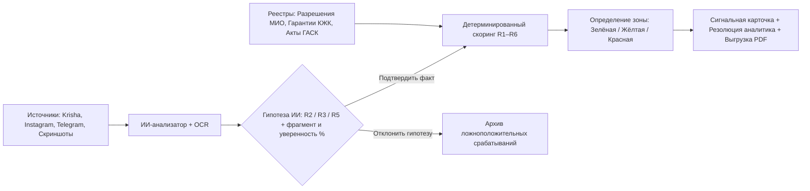

# ClearBuild · SAQ QURYLYS — Интеллектуальный мониторинг рисков в долевом жилищном строительстве

Репозиторий команды **ClearBuild** для кейса **SAQ QURYLYS** (Codemasters Hackathon 8.0, г. Усть-Каменогорск, 14–21 октября 2026 г.).

> **Важное правовое уведомление (Раздел 2 и 7 ТЗ):** Все наименования застройщиков (ТОО), БИН, номера документов и телефоны в `seed.json` и `mockData.js` являются **демонстрационными** и не содержат персональных данных либо обвинений в адрес реальных компаний. Система подсвечивает признаки риска и помогает аналитику МИО приоритизировать проверку, но не устанавливает юридический факт правонарушения и не отправляет материалы в государственные органы автоматически.

---

## 1. Проблема и ценность продукта

Специалисту уполномоченного подразделения МИО / региональному аналитику в Усть-Каменогорске приходится вручную сопоставлять десятки рекламных объявлений на Krisha.kz, OLX, в Instagram и Telegram с реестрами разрешений МИО, гарантиями Единого оператора (АО «КЖК»), выездными актами УГАСК и обращениями граждан.

**Что ускоряет и объединяет ClearBuild (SAQ QURYLYS):**
* **Единая карточка объекта и геомониторинг Усть-Каменогорска:** сводит данные о застройщике, БИН, статусе правового основания (ст. 7, 8, 18 Закона РК «О долевом участии в жилищном строительстве») и динамике готовности на одной интерактивной карте.
* **Объяснимый ИИ-анализатор рекламы и скриншотов (Explainable AI):** автоматически извлекает триггеры незаконного привлечения средств (платная бронь, депозит, ПВ в кассу до регистрации ДДУ), подсвечивает точную фразу-основание, оценивает уверенность модели и предлагает гипотезу фактора риска.
* **Строгий контроль решений человеком (Human-in-the-Loop):** гипотезы ИИ **не начисляют** штрафные баллы автоматически — балл и цветовая зона пересчитываются только после нажатия аналитиком кнопки «Подтвердить факт».
* **Детектор сетевых коллизий (Бонус Раздела 11):** автоматически выявляет связанные рекламные аккаунты и единые номера отделов продаж, которые продвигают сразу несколько строящихся ЖК без разрешений.

---

## 2. Архитектура решения и маршрут сигнала



### Структура монорепозитория

| Путь в репозитории | Назначение компонента |
| :--- | :--- |
| `frontend/index.html` | Основное интерактивное веб-приложение (карта г. Усть-Каменогорска, ИИ-анализатор, печать PDF, RU/KZ локализация) |
| `frontend/src/mocks/mockData.js` | Локальное хранилище демонстрационных данных (8 ЖК и 12 публикаций) с флагом `USE_MOCK_DATA = true` |
| `frontend/src/services/scoring.js` | Клиентский сервис детерминированного расчёта риска R1–R6 |
| `backend/app/main.py` | FastAPI REST-сервер с CORS и эндпоинтами скоринга, анализа и подтверждения факторов |
| `backend/app/scoring.py` | Детерминированный движок расчёта баллов R1–R6 и цветовых зон |
| `backend/tests/test_scoring.py` | Автотесты `pytest` для контрольных тест-сценариев A, B, C и граничных правил |
| `backend/seed.json` | Эталонный JSON-набор из 8 демо-ЖК г. Усть-Каменогорска и 12 рекламных публикаций |
| `backend/requirements.txt` | Зависимости бэкенда (`fastapi`, `uvicorn`, `pydantic`, `pytest`) |
| `docs/` | Папка документации, архитектурных диаграмм и скриншотов |
| `.env.example` | Шаблон переменных окружения без секретных ключей и токенов |
| `.gitignore` | Исключение временных файлов, кэшей и локальных секретов |

---

## 3. Матрица риск-скоринга (R1–R6) и контрольные тест-сценарии

Формула расчёта: `Балл = min(100, сумма весов подтверждённых факторов)`. Неизвестные сведения дают `0` баллов и помечаются статусом `Нужна проверка`.

| Код | Фактор риска | Баллы | Правило учёта |
| :--- | :--- | :--- | :--- |
| **R1** | Установлено отсутствие применимого правового основания | **+35** | Подтверждено отсутствие разрешения МИО и гарантии КЖК («нет данных» = 0 баллов) |
| **R2** | Прямое предложение внести деньги | **+25** | Платная бронь, депозит, первоначальный взнос или резерв до регистрации ДДУ |
| **R3** | Активная реклама строящегося жилья | **+10** | Публикация о продаже/продвижении квартир до ввода объекта в эксплуатацию |
| **R4** | Подтверждённое коллективное обращение | **+15** | Проверенное обращение граждан о привлечении средств по объекту |
| **R5** | Несовпадение заявленной и подтверждённой готовности | **+10** | Разница от 20 процентных пунктов с указанием источников и дат |
| **R6** | Подтверждённый простой / значимая просрочка | **+5** | Документированное отклонение от сроков строительства или длительный простой |

### Контрольные тест-сценарии (Проверка в 1 клик)

| Тест-кейс | Объект в демо-базе | Подтверждённые факторы | Расчёт | Зона риска и правовое обоснование |
| :--- | :--- | :--- | :--- | :--- |
| **Кейс A** | ЖК «Сатпаев Сити Парк» (`jk-2`) | Основание не проверено (`UNVERIFIED`), есть платная бронь (`R2`) и реклама (`R3`) | `25 + 10 = 35` | **Жёлтая зона** — отсутствие данных в открытом реестре не превращается автоматически в `R1` |
| **Кейс B** | ЖК «Ертіс Рівер Тауэрс» (`jk-1`) | Установлено отсутствие основания (`R1`), есть депозит (`R2`) и реклама (`R3`) | `35 + 25 + 10 = 70` | **Красная зона** — балл `60+` и одновременно подтверждены `R1 + R2` |
| **Кейс C** | ЖК «Алтай Премиум Резиденс» (`jk-3`) | Подтверждена действующая гарантия АО «КЖК», есть обычная реклама (`R3`) | `10 = 10` | **Зелёная зона** — при наличии гарантии Единого оператора отдельное разрешение МИО не требуется |
| **Граничный** | ЖК «Нурлы Жол Оскемен» (`jk-5`) | Подтверждены `R1 + R3 + R5 + R6`, а `R2` находится в статусе гипотезы ИИ | `35 + 10 + 10 + 5 = 60` | **Жёлтая зона** — `60+` баллов без одновременной комбинации подтверждённых `R1 + R2` остаётся в Жёлтой зоне до подтверждения `R2` человеком |

---

## 4. Инструкция по быстрому запуску и проверке

### 1. Запуск автотестов скоринга (Backend Pytest)
```bash
pytest backend/tests/test_scoring.py -v
```
Все 4 эталонных теста выполняются за несколько миллисекунд и подтверждают математику Раздела 5 ТЗ.

### 2. Запуск FastAPI REST Backend (опционально)
```bash
# Установка зависимостей (при необходимости)
pip install -r backend/requirements.txt

# Запуск сервера API
python -m uvicorn backend.app.main:app --reload --port 8000
```
Документация Swagger UI доступна по адресу: `http://localhost:8000/docs`

### 3. Запуск веб-интерфейса (Mock-First, без жесткой зависимости от БД)
1. Откройте файл `frontend/index.html` (или `clearbuild_saq_qurylys_app.html`) в любом браузере (либо запустите локальный сервер: `python -m http.server 3000`).
2. На верхней панели доступен тумблер `USE_MOCK_DATA` и выбор языка `RU / KZ`. При выключении тумблера приложение пытается запросить API `http://localhost:8000/api/v1/complexes` с автоматическим безопасным откатом (fallback) на локальные данные, если сервер не запущен.
3. **Демонстрационный сценарий для жюри:**
   * На вкладке **«01 · Карта и Обзор»** нажмите кнопку быстрого перехода **«Граничный кейс: ЖК Нурлы Жол (60 б. без R2 = Жёлтая)»** или **«Кейс B: ЖК Ертіс Рівер Тауэрс»**.
   * Перейдите во вкладку **«03 · Мониторинг рекламы (AI)»**, выберите пресет объявления или вставьте любой новый текст рекламы и нажмите **«Анализировать текст»**.
   * Нажмите **«Подтвердить факт (+25 б. в скоринг)»** — система зафиксирует имя аналитика в журнале аудита, пересчитает балл объекта и переведёт ЖК в Красную зону.
   * Перейдите во вкладку **«05 · Сигнальная карточка»**, нажмите **«Подтвердить сигнал»** и выгрузите официальный отчёт кнопкой **«Скачать PDF / Печать карточки»**.

---

## 5. Известные ограничения и план развития после хакатона
* В рамках хакатона внешние государственные источники (Казреестр, УГАСК ВКО, реестр гарантий АО «КЖК», e-Otinish) подключены через локальные демонстрационные адаптеры (`seed.json`), чтобы исключить зависимость от закрытых ведомственных контуров.
* После хакатона предусмотрено подключение REST-адаптеров к открытым витринам данных `egov.kz` и автоматический сбор публичных объявлений по расписанию (Celery + Playwright) с сохранением криптографического хеша скриншотов.
