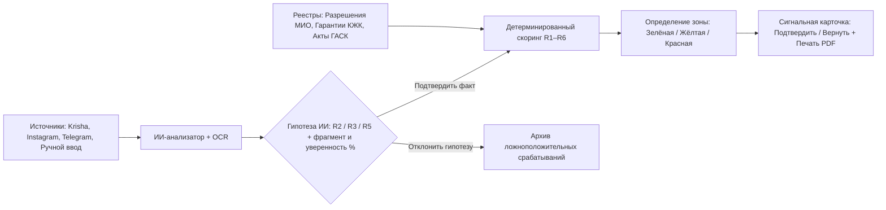

# ClearBuild · SAQ QURYLYS — Интеллектуальный мониторинг рисков в долевом жилищном строительстве

Репозиторий команды **ClearBuild** для кейса **SAQ QURYLYS** (Codemasters Hackathon 8.0, г. Усть-Каменогорск, 14–21 октября 2026 г.).

🌐 **Демо-стенд онлайн (Live Demo):** [https://komputerny-oslik.site](https://komputerny-oslik.site)  
📦 **Репозиторий проекта:** [https://github.com/Raul894123/ClearBuild](https://github.com/Raul894123/ClearBuild)  
📑 **Генеральный паспорт и мастер-руководство проекта:** [CLEARBUILD_MASTER_GUIDE.md](CLEARBUILD_MASTER_GUIDE.md)

> **Важное правовое уведомление (Раздел 2 и 7 ТЗ):** Все наименования застройщиков (ТОО), БИН, номера документов и телефоны в `seed.json` и `mockData.js` являются **демонстрационными** и не содержат персональных данных либо обвинений в адрес реальных компаний. Система подсвечивает признаки риска и помогает аналитику МИО приоритизировать проверку, но не устанавливает юридический факт правонарушения и не отправляет материалы в государственные органы автоматически.

---

## 1. Проблема и ценность продукта

Специалисту уполномоченного подразделения МИО / региональному аналитику в Усть-Каменогорске приходится вручную сопоставлять десятки рекламных объявлений на Krisha.kz, OLX, в Instagram и Telegram с реестрами разрешений МИО, гарантиями Единого оператора (АО «КЖК»), выездными актами УГАСК и обращениями граждан.

**Что ускоряет и объединяет ClearBuild (SAQ QURYLYS):**
* **Интерактивная карта OpenStreetMap г. Усть-Каменогорска:** объекты нанесены с точными GPS-координатами, цветовыми метками риска (Красная / Жёлтая / Зелёная) и баллами. Доступны тёмный и светлый стили тайлов OSM.
* **Единая карточка объекта (Реестр ЖК):** сводит данные о застройщике, БИН, статусе правового основания (ст. 7, 8, 18 Закона РК «О долевом участии в жилищном строительстве»), расхождении заявленной и фактической готовности.
* **Объяснимый ИИ-анализатор рекламы (Explainable AI):** автоматически извлекает условия оплаты (платная бронь, депозит, первоначальный взнос до ДДУ), выделяет подозрительный фрагмент (`triggerSpan`), оценивает уверенность модели (`confidence %`) и предлагает гипотезу фактора риска.
* **Ручное добавление публикаций (Раздел 3 и 4 ТЗ):** аналитик может в 1 клик добавить любое новое объявление с любой площадки и мгновенно прогнать его через ИИ-анализ.
* **Строгий контроль решений человеком (Human-in-the-Loop):** гипотезы ИИ **не начисляют** штрафные баллы автоматически — балл и цветовая зона пересчитываются только после нажатия аналитиком кнопки «Подтвердить факт».
* **Сигнальная карточка с резолюцией и печатью PDF:** поддержка статусов «Подтвердить сигнал» и «Вернуть на доработку», фиксация ФИО аналитика, даты, времени и официальный бланк для выгрузки.
* **Детектор сетевых коллизий (Бонус Раздела 11):** автоматическое выявление риелторских сетей и общих номеров телефонов, продвигающих разные объекты без разрешений.

---

## 2. Архитектура решения и маршрут сигнала



### Структура монорепозитория

| Путь в репозитории | Назначение компонента |
| :--- | :--- |
| `index.html` / `frontend/index.html` | Основное веб-приложение: карта OpenStreetMap, 5 модулей MVP, ИИ-анализ, печать PDF, RU/KZ |
| `js/data.js` / `frontend/js/data.js` | Синхронизированная с `backend/seed.json` база данных (8 ЖК и 12 публикаций, автономный fallback) |
| `js/api.js` / `frontend/js/api.js` | REST-клиент (`getComplexes`, `getComplexById`, `getPublications`, `verifyPublication`, `analyze`, `confirmFactor`, `getAuditLog`) |
| `js/shared.js` / `frontend/js/shared.js` | Детерминированный скоринг R1–R6, синхронизация с бэкендом (`syncWithBackend`) и досье ЖК |
| `backend/app/main.py` | FastAPI REST-сервер с SQLite (`SQLAlchemy` + `seed.json`) и полным набором эндпоинтов `/api/v1/*` |
| `backend/app/scoring.py` | Детерминированный движок расчёта баллов R1–R6 и цветовых зон |
| `backend/app/factors.py` | Матрица факторов R1–R6, жёсткие предусловия (`R1`, `R5`, `R6`) и эталонная сверка `SEED_EXPECTED` |
| `backend/app/analyzer.py` | Детерминированный NLP-анализатор публикаций (`hypotheses[]` по R2, R3, R5 + поиск ЖК и коллизий) |
| `backend/tests/` | 135 автотестов `pytest` (`test_scoring.py`, `test_analyzer.py`, `test_api.py`, `test_factors.py`, `test_repository.py`) |
| `backend/seed.json` | Эталонный JSON-набор из 8 демо-ЖК г. Усть-Каменогорска и 12 рекламных публикаций |
| `backend/DATA_DIFF.md` | Справка по синхронизации `backend/seed.json` и `js/data.js` |
| `backend/requirements.txt` | Зависимости бэкенда (`fastapi`, `uvicorn`, `pydantic`, `sqlalchemy`, `httpx`, `pytest`) |

### Эндпоинты REST API (`/api/v1`)

| Метод и маршрут | Назначение |
| :--- | :--- |
| `GET /api/v1/health` | Проверка доступности сервера, статуса SQLite и количества ЖК / публикаций |
| `GET /api/v1/complexes?zone=` | Список всех ЖК с расчётом скоринга и опциональной фильтрацией по зоне (`RED`, `YELLOW`, `GREEN`) |
| `GET /api/v1/complexes/{id}` | Полное досье ЖК: `publications[]`, `signal` и детальный `riskProfile.factors[]` (R1–R6) |
| `POST /api/v1/complexes/{id}/confirm-factor` | Подтверждение или отклонение фактора риска аналитиком с проверкой предусловий и записью в `audit_log` |
| `GET /api/v1/publications` | Список рекламных публикаций (фильтры `complex_id`, `platform`, `status`) |
| `POST /api/v1/publications/{id}/verify` | Верификация публикации аналитиком (`{"decision": "accept" \| "reject"}`) с автоматическим пересчётом R2/R3/R5 |
| `POST /api/v1/analyze` | ИИ-анализ объявления: возвращает массив `hypotheses[]` (одновременно R2, R3 и R5), `complexId` (или `null` + `candidates[]`) и `proposedFactor` (может быть `null`) |
| `GET /api/v1/audit-log` | Журнал решений аналитиков МИО (последние записи из таблицы `audit_log`) |

---

## 3. Матрица риск-скоринга (R1–R6) и контрольные тест-сценарии

Формула расчёта: `Балл = min(100, сумма весов подтверждённых факторов)`. Неизвестные сведения дают `0` баллов и помечаются статусом `Нужна проверка`.

| Код | Фактор риска | Баллы | Правило учёта |
| :--- | :--- | :--- | :--- |
| **R1** | Установлено отсутствие применимого правового основания | **+35** | Подтверждено отсутствие разрешения МИО и гарантии КЖК («нет данных» = 0 баллов) |
| **R2** | Прямое предложение внести деньги | **+25** | Платная бронь, депозит, первоначальный взнос или резерв до регистрации ДДУ |
| **R3** | Активная реклама строящегося жилья | **+10** | Публикация о продаже/продвижении квартир до ввода объекта в эксплуатацию |
| **R4** | Подтверждённое коллективное обращение | **+15** | Проверенное обращение граждан о привлечении средств по объекту |
| **R5** | Несовпадение заявленной и подтверждённой готовности | **+10** | Разница от 20 процентных пунктов с указанием источников и дат |
| **R6** | Подтверждённый простой / значимая просрочка | **+5** | Документированное отклонение от сроков строительства или длительный простой |

### Контрольные тест-сценарии (Проверка в 1 клик)

| Тест-кейс | Объект в демо-базе | Подтверждённые факторы | Расчёт | Зона риска и правовое обоснование |
| :--- | :--- | :--- | :--- | :--- |
| **Кейс A** | ЖК «Сатпаев Сити Парк» (`jk-2`) | Основание не проверено (`UNVERIFIED`), есть платная бронь (`R2`) и реклама (`R3`) | `25 + 10 = 35` | **Жёлтая зона** — отсутствие данных в открытом реестре не превращается автоматически в `R1` |
| **Кейс B** | ЖК «Ертис Тауэрс» (`jk-1`) | Установлено отсутствие основания (`R1`), есть депозит (`R2`) и реклама (`R3`) (+ обращение `R4` в проверке) | `35 + 25 + 10 = 70` (`85` с `R4`) | **Красная зона** — балл `60+` и одновременно подтверждены `R1 + R2` |
| **Кейс C** | ЖК «Алтай Премиум Резиденс» (`jk-3`) | Подтверждена действующая гарантия АО «КЖК», есть обычная реклама (`R3`) | `10 = 10` | **Зелёная зона** — при наличии гарантии Единого оператора отдельное разрешение МИО не требуется |
| **Граничный** | ЖК «Нурлы Жол Оскемен» (`jk-5`) | Подтверждены `R1 + R3 + R5 + R6`, а `R2` находится в статусе гипотезы ИИ (`AD-105`) | `35 + 10 + 10 + 5 = 60` | **Жёлтая зона** — `60+` баллов без одновременной комбинации подтверждённых `R1 + R2` остаётся в Жёлтой зоне до подтверждения `R2` человеком |

---

## 4. Пошаговая инструкция по запуску

Приложение спроектировано по принципу **Live API + Offline Fallback**: при запущенном FastAPI-сервере фронтенд автоматически вызывает `getComplexes()`, `getPublications()`, `getAuditLog()`, `analyze()` и `verifyPublication()`, отображая живые данные из SQLite (`clearbuild.db`). Если бэкенд не запущен, интерфейс бесшовно работает на синхронизированном `js/data.js`.

### Вариант 1. Запуск бэкенда на FastAPI (SQLite)
1. Перейдите в директорию `backend` и установите зависимости:
   ```bash
   cd backend
   pip install -r requirements.txt
   ```
2. Запустите сервер FastAPI **из папки `backend`** (так как внутри пакета используются импорты `from app...`):
   ```bash
   uvicorn app.main:app --reload --port 8000
   ```
   *(Либо `python -m uvicorn app.main:app --reload --port 8000`, находясь в директории `backend`).*
   * Проверка статуса сервера: `http://localhost:8000/api/v1/health`
   * Интерактивная документация Swagger UI: `http://localhost:8000/docs`

### Вариант 2. Запуск веб-интерфейса
1. Из корня репозитория запустите статический веб-сервер:
   ```bash
   python -m http.server 3000
   ```
   И откройте в браузере `http://localhost:3000/` (или откройте `index.html` напрямую).
2. При старте страницы фронтенд автоматически проверит `http://localhost:8000/api/v1/health`, переведёт индикатор в шапке в статус **«🟢 API Подключен»** и загрузит живые данные через `getComplexes()`, `getPublications()` и `getAuditLog()`.

### Вариант 3. Запуск автотестов pytest (135 тестов)
```bash
cd backend
pytest
```
Все 135 автотестов проверяют скоринг R1–R6, жёсткие предусловия факторов, SQLite-репозиторий, NLP-анализатор (`hypotheses[]`, `candidates[]`) и все REST-эндпоинты.

---

## 5. Сценарий живой демонстрации для жюри (5 минут)

1. **Вкладка «01 · Карта и Обзор»**:
   * Покажите карту OpenStreetMap г. Усть-Каменогорска. Переключите стиль кнопками `🌙 Тёмная` / `☀️ Светлая`.
   * Нажмите на метку любого ЖК на карте (например, Красная зона `70 б.`) — карта плавно сфокусируется (`flyTo`), откроется балун с реквизитами застройщика и правовым основанием.
   * Нажмите кнопку быстрого перехода: **«⚡ Граничный кейс: «Нурлы Жол» (60 б. без R2 = Жёлтая)»**. Обратите внимание жюри на тонкость ТЗ: объект набрал 60 баллов, но находится в Жёлтой зоне, так как фактор R2 ещё не подтверждён человеком.
2. **Вкладка «03 · Мониторинг рекламы»**:
   * Выберите пресет **«⚡ Пресет 2: Депозит по ЖК «Нурлы Жол»»** или нажмите **«➕ Добавить публикацию вручную»** и введите текст со словами «платный депозит 400 000 ₸».
   * Нажмите **«Анализировать текст»** — ИИ подсветит триггер сбора денег (`triggerSpan`), выдаст оценку уверенности (94%) и предложит гипотезу R2.
   * Нажмите **«Подтвердить факт (+25 б. в скоринг)»** — система запишет имя аналитика в журнал аудита, мгновенно пересчитает балл ЖК с 60 до 85 и переведёт объект в **Красную зону** прямо на глазах жюри!
3. **Вкладка «05 · Сигнальная карточка»**:
   * В карточке отобразится полная доказательная база с выписками ГАСК, реестром КЖК и найденной рекламой.
   * Введите комментарий аналитика и нажмите **«✅ Подтвердить сигнал»** (или **«↩️ Вернуть на доработку»**) — появится официальный штамп ведомства.
   * Нажмите **«🖨️ Скачать PDF / Печать карточки»** — откроется диалог печати официального бланка А4 для передачи материалов комиссии.
