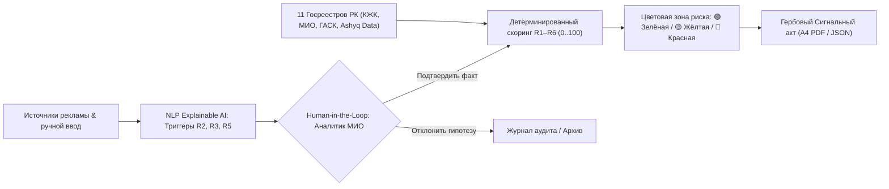

# Архитектура ClearBuild · SAQ QURYLYS

Аналитический комплекс мониторинга законности долевого жилищного строительства (ДЖС) в Республике Казахстан.

---

## 1. Поток данных и обработка сигналов

1. **Сбор и мониторинг:** Рекламные публикации с Krisha.kz, Instagram, Telegram, OLX и наружных носителей поступают во входной буфер или вводятся аналитиком вручную.
2. **Explainable AI (Объяснимый ИИ):** Модуль лингвистических правил и взвешенных эвристик анализирует текст и OCR, выявляет признаки прямого сбора средств (`R2`), рекламы до ввода (`R3`) и завышения готовности (`R5`), подсвечивает точный фрагмент (`triggerSpan`) и рассчитывает уверенность модели (`confidence %`).
3. **Человек в контуре (Human-in-the-Loop):** Гипотезы ИИ имеют статус `AI_HYPOTHESIS` и дают **0 штрафных баллов**. Балл начисляется исключительно после осознанного решения аналитика МИО нажатием кнопки «Подтвердить факт».
4. **Детерминированный скоринг (R1–R6):** Суммируются веса подтверждённых факторов: `min(100, sum)`. Строго соблюдается граничное правило ТЗ (*Edge Case*): если балл $\ge 60$, но не подтверждена одновременная пара $R1 + R2$, объект остаётся в **Жёлтой зоне**.
5. **Сигнальная карточка и гербовый акт:** Генерация официального акта первичного реагирования ГУ «Управление строительства, архитектуры и градостроительства ВКО» с гербовыми штампами ведомства, резолюцией аналитика, журналом аудита и выводом на печать бланка А4.

---

## 2. Геоинформационный контур и высокоскоростной геокодер

- **Интерактивная карта OpenStreetMap (Leaflet):** отображает все строящиеся объекты на реальных контурах зданий с цветовой кодировкой рисков.
- **3-уровневый отказоустойчивый геокодер:**
  1. *Tier 1 (Instant Local Trie / Dictionary):* мгновенный поиск (< 5 мс) по нормализованной базе улиц и ориентиров с поддержкой казахских и русских синонимов (например, *пр. Победы / Жеңіс даңғылы*).
  2. *Tier 2 (OpenStreetMap JSONP):* резервный запрос к картографическому сервису без блокировок CORS.
  3. *Tier 3 (Offline Heuristics):* локальное сопоставление с ближайшими известными строительными кварталами.
- **Интерактивный пикер точки на карте («Указать на карте»):**
  - Полноэкранная карта с перетаскиваемым пином в модальном окне добавления ЖК.
  - Автоматическое обратное геокодирование (*reverse geocoding*) координат клика в текстовый адрес.
  - Кнопка подтверждения точки («Подтвердить точку») для защиты от случайных кликов.

---

## 3. Персистентность и управление данными (CRUD)

- **Гибридная архитектура (Live API + Offline Fallback):** приложение работает с REST API на FastAPI/SQLite (`/api/v1/*`), а при недоступности бэкенда прозрачно переключается на встроенный движок локального состояния (`localStorage`).
- **Персистентное удаление ЖК:**
  - Эндпоинт `DELETE /api/v1/complexes/{id}` производит полное удаление объекта из базы данных SQLite с каскадной очисткой привязанных публикаций, сигналов и записей аудита.
  - Внедрена защита от кэширования ответов браузером (cache-busting), гарантирующая, что удалённый объект не восстановится из кэша.

---

## 4. Фирменный брендинг и визуальная айдентика

- **Векторный логотип (`favicon.svg`):** современный civic-tech стиль — глубокий градиентный сквиркл, силуэт трёх высоток со светящимися окнами, золотой шпиль и изумрудный щит безопасности «SAQ».
- **Мульти-разрешение и кроссплатформенность:**
  - `favicon.ico`: 16×16, 32×32, 48×48, 64×64, 128×128, 256×256 px.
  - `favicon.png` и `apple-touch-icon.png`: 512×512 px для мобильных закладок и дисплеев Retina.
- **Единый стиль:** логотип интегрирован в навигационную панель сайта (`.brand-badge`) и подключен во все HTML-страницы системы.

---

## 5. Контроль качества и тестирование

Автоматизированный тестовый набор `pytest` содержит **202 теста**:
- `test_scoring.py`: формулы скоринга, веса R1–R6, цветовые зоны, контрольные кейсы A/B/C и граничное правило 60+ баллов;
- `test_factors.py`: логика и жёсткие ограничения факторов риска;
- `test_analyzer.py`: лингвистические правила NLP-детектора, уверенность и извлечение триггеров;
- `test_geocoding.py`: скорость и точность нормализации адресов и привязки координат;
- `test_registries.py`: проверка интеграций с 11 госреестрами РК и импорт выгрузок Ashyq Data (CSV/JSON);
- `test_api.py` и `test_endpoints.py`: контрактная валидация всех REST-эндпоинтов, сидирования и CRUD-операций.
